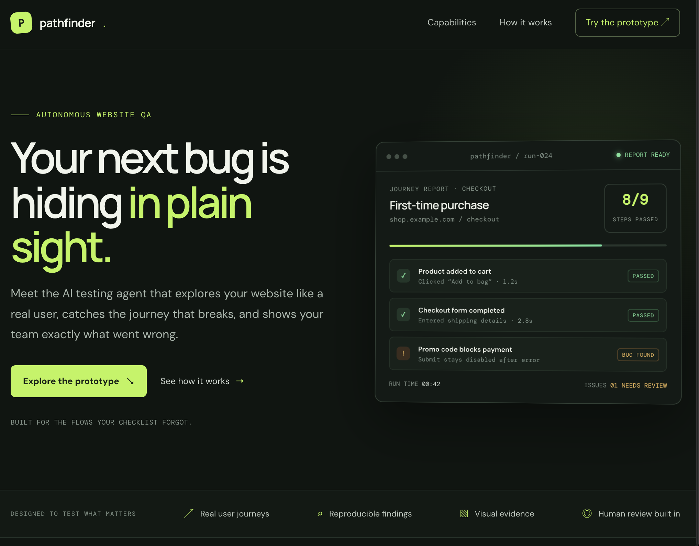
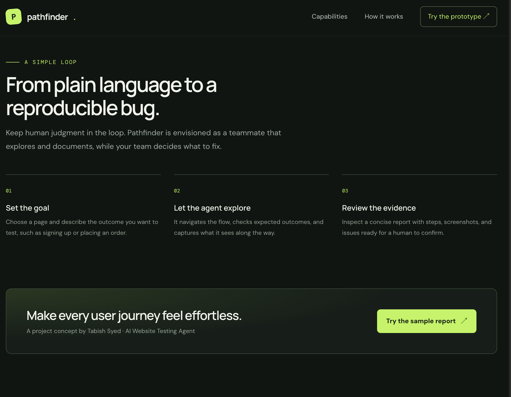

# Pathfinder — AI Website Testing Agent

  <a href="https://tabishsyed777.github.io/AI-website-testing-agent/"><strong>Open the live project site ↗</strong></a>
   
  

Pathfinder is a project concept for an AI agent that explores website user journeys, catches broken flows, and turns findings into clear, reproducible reports.

## Project preview

  
   
  <em>The landing page and sample audit report</em>

  
   
  <em>The three-step flow: set a goal, explore, and review the evidence</em>

## What it is

The envisioned agent would:

- Follow user journeys described in plain language
- Detect broken or confusing behavior across pages and forms
- Produce reproduction steps and visual evidence for a person to review

## Try the prototype

Visit the [live Pathfinder site](https://tabishsyed777.github.io/AI-website-testing-agent/) and scroll to **Try the concept**. The “Run sample” control is an interactive mockup: it displays sample findings and does not scan or connect to the URL entered.

## Run locally

Open `index.html` in a browser. The site is a self-contained static page with no build step.

## Deployment

GitHub Actions deploys the repository to GitHub Pages on each push to `main`. The publishing source is set to **GitHub Actions** under **Settings → Pages**.
